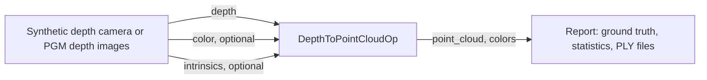

# Depth to Point Cloud

This application turns depth images into point clouds on the GPU. Its core is
one reusable Holoscan SDK 5 operator, `DepthToPointCloudOp`: a depth image from
a depth camera, a stereo matcher or a monocular depth network goes in, with
pinhole intrinsics, and an organized point cloud comes out, optionally colored
from an aligned color image. It is the step from 2D perception to 3D: mapping,
ground and obstacle estimation, registration, grasp planning and point-cloud
tools all start from it.



## What it computes

For each pixel `(u, v)` with metric depth `Z = raw_depth * depth_scale`, the
point in the camera optical frame (x right, y down, z forward) is:

```text
X = (u - cx) * Z / fx
Y = (v - cy) * Z / fy
Z = Z
```

Pixel centers are at integer coordinates, as in OpenCV and ROS `CameraInfo`.
Zero, negative and non-finite depths, and depths outside
`[depth_min, depth_max]`, become `(NaN, NaN, NaN)` (or another chosen invalid
value). The cloud stays organized, `H x W x 3`, so pixel neighbors stay
neighbors for normals and segmentation. One CUDA thread handles one pixel.

For a body frame such as ROS's (x forward, y left, z up), rotate the cloud
downstream.

## The operator

| Port | Direction | Type |
| --- | --- | --- |
| `depth` | in | `ImageT`: `MONO16` (raw units, scaled by `depth_scale`) or `MONO32F`, `[H, W]` or `[H, W, 1]`, host or device memory |
| `color` | in, optional | `ImageT`: `RGB8`, `BGR8`, `RGBA8` or `BGRA8`, the depth image's size |
| `intrinsics` | in, optional | `Tensor`: float32 `[fx, fy, cx, cy]` for the depth image with the same capture time, in host or device memory |
| `point_cloud` | out | `Tensor`: float32 `[H, W, 3]`, meters, device memory |
| `colors` | out, with `color` | `Tensor`: uint8 `[H, W, 3]` RGB per point, device memory |

The optional ports exist only when configured. With them, the operator runs
once per frame when the depth, color and intrinsics with exactly the same
capture time have all arrived; a depth image without them gives no cloud.
Intrinsics must therefore come with every depth image, stamped like it: a
camera that sends them at their own rate never completes a frame, and the
graph produces nothing. If the intrinsics do not change, configure them
instead. Outputs carry the depth image's capture time and frame id.

| Setting | Default | Meaning |
| --- | --- | --- |
| `intrinsics` | none | `{fx, fy, cx, cy}` in pixels; give these or set `intrinsics_input`, not both |
| `depth_scale` | `0.001` | Raw depth to meters: `0.001` for uint16 millimeters, `1.0` for float32 meters |
| `depth_min`, `depth_max` | `0`, `100` | Valid depth range in meters |
| `invalid_value` | `NaN` | Written to X, Y and Z of invalid pixels |
| `color` | `false` | Declare the `color` input and `colors` output |
| `intrinsics_input` | `false` | Declare the `intrinsics` input, for intrinsics that change from frame to frame |
| `max_width`, `max_height` | `1920`, `1080` | Largest image the outputs are sized for |

Rows must be packed, and data in device memory aligned to its element size
(4 bytes for four-channel color). The operator rejects an unsupported
encoding, a color image of another size, an image larger than its maximum, or
unusable intrinsics in host memory, with an error that says so. Intrinsics in
device memory are read by the kernel, so the host never waits for them;
unusable ones (a focal length that is not positive and finite, or a center
that is not finite) make every point of that frame invalid instead.

### Use it in your graph

```cpp
#include "operators/depth_to_point_cloud_op.hpp"

auto cloud = graph.op<depth_to_point_cloud::DepthToPointCloudOp>(
    "deproject", depth_to_point_cloud::DepthToPointCloudConfig{
                     .intrinsics = depth_to_point_cloud::CameraIntrinsics{615.0F, 615.0F, 319.5F, 239.5F},
                     .depth_scale = 0.001F,  // uint16 millimeters
                     .depth_min = 0.1F,
                     .depth_max = 10.0F,
                     .max_width = 640,
                     .max_height = 480});
graph.add_flow(camera->depth, cloud->depth);              // Input<schema::ImageT>
graph.add_flow(cloud->point_cloud, consumer->points);    // Output<Tensor>
```

The outputs are in device memory, so bind their GPU when compiling, as
`main.cpp` does:

```cpp
holoscan::CompileOptions options;
options.deployment.bind_tensor_output_device(holoscan::TensorOutputDevicePlacement{
    .operator_path = "deproject", .output_port = "point_cloud", .device = holoscan::DeviceId{0}});
const auto plan = holoscan::compile(graph, std::move(options));
```

The operator is not installed as a library. To use it in another application,
build `cpp/operators/depth_to_point_cloud_op.cpp` and the `cpp/deproject/`
sources with it; within this application's CMake project, link the
`depth_to_point_cloud_operators` target. The kernel itself
(`cpp/deproject/deproject.cu`) has no Holoscan dependency.

### Differences from the SDK 4 version

The operator was first written for Holoscan SDK 4. Besides the SDK 5 API, this
version differs in these ways:

- It is configured with a `DepthToPointCloudConfig` passed to its
  constructor, not with parameters, and takes no allocator or tensor names:
  outputs come from the runtime's memory pool.
- `depth` and `color` are `schema::ImageT` images, whose encoding gives the
  element type and channel order, rather than entities holding tensors. BGR
  color is accepted, and so is input in host memory.
- Points and colors leave on two ports, `point_cloud` and `colors`, rather
  than as two tensors of one entity.
- The optional ports are declared only when configured, and their samples are
  paired with the depth image by exact capture time; the SDK 4 operator used
  whatever had arrived. Configured intrinsics and the `intrinsics` input are
  exclusive.
- It has no Python binding yet.

## Dependencies

- Linux on x86_64 or aarch64 with an NVIDIA GPU and a compatible driver.
- Holoscan SDK 5.0 Core and Sensor I/O, and for the tests, Testing.
- CMake 4.0+, a C++20 compiler and the CUDA toolkit.
- Python 3.12–3.14 and the CLI pinned in the repository's
  [requirements.txt](../../requirements.txt) for repository workflows.

The application downloads nothing and needs no models. The `images` mode reads
your own depth images; every other mode renders its frames.

## Build and run

From the repository root, choose a development image matching the SDK:

```bash
export HOLOSCAN_CLI_BASE_IMAGE=nvcr.io/nvidia/clara-holoscan/holoscan:v5.0.0-cuda13
holoscan run depth_to_point_cloud
holoscan run depth_to_point_cloud ci
```

To build and run on the host instead, install the dependencies, set
`HOLOSCAN_SDK_ROOT` to the SDK installation and add `--local`.

| Mode | Behavior |
| --- | --- |
| `synthetic` (default) | 300 frames of a synthetic depth camera with color, every point and color checked against ground truth. |
| `images` | Deprojects the PGM depth images in `data/depth_to_point_cloud`. |
| `ci` | 30 synthetic uint16 frames with color and per-frame intrinsics, checked against ground truth. |

The synthetic camera sees a tilted plane with a dome, small holes with no
depth, and a patch too far away to be valid, all moving from frame to frame.
Each run prints the frame and point counts, the valid points and their depth
range and, for synthetic input, how many points and colors differ from the
truth. A gap in the frame ids fails the run and is printed too. Then comes a
`verdict`: `PASS`, `FAIL`, or `STOPPED` when an interrupt ends the run early.
It exits nonzero unless the verdict is `PASS`.

`--run-args` appends options to the mode's command, for example
`--run-args='--depth-format millimeters --host-input true'`. `--ply-dir DIR`
writes each cloud as `DIR/frame_NNNNNN.ply`, which any point-cloud viewer
opens. Run the executable with `--help` for every option.

The modes build the application without its tests; `holoscan test` builds
them separately.

### Your own depth images

The image source reads binary PGM files, 8- or 16-bit, as depth cameras and
image tools save them; 16-bit samples are big-endian, as the format specifies.
Give the camera's intrinsics, and the depth scale if the images are not in
millimeters:

```bash
mkdir -p data/depth_to_point_cloud   # put the .pgm files here
holoscan run depth_to_point_cloud images \
  --run-args='--fx 615 --fy 615 --cx 319.5 --cy 239.5 --ply-dir .'
```

The command runs in the application's build directory,
`build/depth_to_point_cloud/applications/depth_to_point_cloud`, so
`--ply-dir .` writes the clouds there: inside the repository, where they
outlive the container. With `--local`, any host directory works.

## Performance

On an RTX 5090 (driver 595.91.07) with SDK 5.0.0 and CUDA 13.2, the
deprojection kernel takes a median of 6.5 µs per 1280x720 float32 frame and
6.4 µs per uint16 frame, colors included. Measured with Nsight Systems
2026.4.1 over 200 frames, from the kernel summary
(`nsys stats --report cuda_gpu_kern_sum`) of:

```bash
nsys profile -t cuda --sample=none --cpuctxsw=none -o depth \
  ./depth_to_point_cloud --width 1280 --height 720 --count 200 --depth-format meters
nsys profile -t cuda --sample=none --cpuctxsw=none -o depth_mm \
  ./depth_to_point_cloud --width 1280 --height 720 --count 200 --depth-format millimeters
```

## Standalone build

```bash
cmake -S applications/depth_to_point_cloud -B build/depth-standalone \
  -Dholoscan_ROOT="$HOLOSCAN_SDK_ROOT" -DCMAKE_CUDA_ARCHITECTURES=native \
  -DBUILD_TESTING=OFF
cmake --build build/depth-standalone --parallel
./build/depth-standalone/depth_to_point_cloud --count 30
```

`-DBUILD_TESTING=OFF` leaves out the tests, which need the SDK's testing
component.

## Tests

```bash
holoscan test depth_to_point_cloud --no-xvfb
```

To build and test on the host instead, set `HOLOSCAN_SDK_ROOT` as above and
add `--local`.

The suite checks:

- The kernel against a CPU reference: float32 and uint16 depth, holes, the
  valid range, non-finite depth, every color layout, and image sizes that are
  not a multiple of the block size.
- The PGM reader: 8- and 16-bit samples, header comments, and malformed files.
- The operator on its own, through the SDK's operator test harness: host and
  device input, color in every encoding and per-frame intrinsics, the capture
  time and frame id of the outputs, frames whose intrinsics carry another
  capture time, and the rejection of unusable inputs and settings.
- The application on synthetic frames, every point and color checked against
  ground truth, and on a folder of 16-bit PGM depth images, once and looped.
- PLY output, and the exit status and verdict of failed, timed-out, stopped
  and invalid runs.

All of it needs the SDK and a GPU; none of it needs data.

Validated on x86_64 (RTX 5090) with SDK 5.0.0 and CUDA 13.2. aarch64 builds
have not been run yet.

## License

Apache 2.0.
