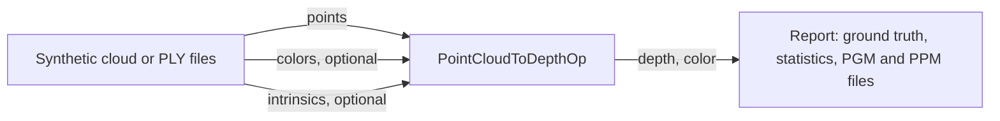

# Point Cloud to Depth

This application turns point clouds into depth images on the GPU. Its core is
one reusable Holoscan SDK 5 operator, `PointCloudToDepthOp`: a point cloud from
a lidar, a depth camera, a stereo matcher or a map goes in, with the pose of a
pinhole camera, and a depth image as that camera would see the points comes
out, optionally with their colors. It is the step from 3D back to 2D: lidar
depth for image networks, depth completion and fusion with camera images,
virtual cameras over a map, and depth supervision for training.



## What it computes

Each point `p` is first moved into the camera optical frame (x right, y down,
z forward) by the configured extrinsics, a 3x4 row-major `[R | t]`:
`(x, y, z) = R * p + t`. Then it projects to

```text
u = fx * x / z + cx
v = fy * y / z + cy
```

and lands on the pixel nearest `(u, v)`, `(lroundf(u), lroundf(v))`, with
pixel centers at integer coordinates, as in OpenCV and ROS `CameraInfo`. Each
pixel keeps the nearest point: a z-buffer of one 64-bit key per pixel, the
point's depth above its index, written with `atomicMin`. Among equally near
points the lower index wins, so the image does not depend on thread
scheduling. A second kernel turns the winning keys into depth and color.

Points are dropped when a coordinate is not finite, when `z` is not positive
(behind the camera) or lies outside `[depth_min, depth_max]`, and when their
pixel is outside the image. With `point_size` 3 or 5, a point covers the
square of that many pixels a side around its pixel, clipped at the image
border; a point whose own pixel is outside the image draws nothing. Pixels no
point reaches are 0, and black in the color image.

The depth image is float32 meters, or uint16 counts of `depth_scale` meters,
`round(z / depth_scale)` rounded half away from zero. A uint16 depth cannot
hold a point whose count would be 0, which marks an empty pixel, or above
65535: such a point is dropped rather than saturated, so a pixel never shows a
depth no point has, and the next point behind it can show through instead.

Deprojecting a depth image with some intrinsics and projecting the points
back with the same ones gives the image back exactly; the tests check that.

## The operator

| Port | Direction | Type |
| --- | --- | --- |
| `points` | in | `Tensor`: float32 `[N, 3]`, or an organized `[H, W, 3]` taken as `H * W` points; host, pinned or device memory |
| `colors` | in, with `color` | `Tensor`: uint8 RGB, the points' shape |
| `intrinsics` | in, with `intrinsics_input` | `Tensor`: float32 `[fx, fy, cx, cy]` for the cloud with the same capture time, in host or device memory |
| `depth` | out | `ImageT`: `MONO32F` meters or `MONO16` counts, `[height, width]`, device memory |
| `color` | out, with `color` | `ImageT`: `RGB8`, `[height, width, 3]`, device memory |

The optional ports exist only when configured. With them, the operator runs
once per cloud when the colors and intrinsics with exactly the same capture
time have all arrived; a cloud without them gives no image. Intrinsics must
therefore come with every cloud, stamped like it: a sensor that sends them at
their own rate never completes a frame, and the graph produces nothing. If the
intrinsics do not change, configure them instead. Outputs carry the cloud's
capture time and frame id, and each image's header holds the capture time and
the configured `frame_id`.

The depth image of a frame goes out before its color image. Should the color
then fail to go out, the depth image has been delivered alone and the frame
fails. Pair the two by capture time, as the application's report does, and
connect a consumer that only displays them with `QueuePolicy::kDropOldest`, so
that it never pushes back.

| Setting | Default | Meaning |
| --- | --- | --- |
| `width`, `height` | `640`, `480` | Depth image size in pixels, 1..16384 |
| `intrinsics` | none | `{fx, fy, cx, cy}` in pixels; give these or set `intrinsics_input`, not both |
| `extrinsics` | none (identity) | 3x4 row-major `[R \| t]` from the points' frame into the camera optical frame |
| `depth_min`, `depth_max` | `0`, `100` | Valid depth range in meters |
| `depth_format` | `kFloat32` | `kFloat32` meters, or `kUint16` counts of `depth_scale` meters |
| `depth_scale` | `0.001` | Meters per uint16 count: millimeters by default |
| `point_size` | `1` | Pixels a side each point covers: 1, 3 or 5 |
| `color` | `false` | Declare the `colors` input and `color` output |
| `frame_id` | empty | The camera's coordinate frame, for the images' headers |
| `intrinsics_input` | `false` | Declare the `intrinsics` input, for intrinsics that change from frame to frame |
| `max_points` | `16777216` | Largest cloud accepted, up to 2^30 points; a larger one fails the frame |

Inputs must be packed, and points and intrinsics in device memory aligned to
4 bytes. Inputs in device memory must be on the operator's GPU. The operator
rejects another element type or shape, colors that do not match the points, a
cloud above `max_points`, or unusable intrinsics in host memory, with an error
that says so. Intrinsics in device memory are read by the kernel, so the host
never waits for them; unusable ones (a focal length that is not positive and
finite, or a center that is not finite) leave that frame's image empty
instead. Clouds in host memory are copied to the GPU
through a staging buffer that grows with the largest cloud seen.

### Use it in your graph

```cpp
#include "operators/point_cloud_to_depth_op.hpp"

namespace pcd = point_cloud_to_depth;

auto project = graph.op<pcd::PointCloudToDepthOp>(
    "project", pcd::PointCloudToDepthConfig{
                   .width = 640,
                   .height = 480,
                   .intrinsics = pcd::CameraIntrinsics{615.0F, 615.0F, 319.5F, 239.5F},
                   // Lidar x forward, y left, z up into the camera optical frame,
                   // the lidar 10 cm above the camera.
                   .extrinsics = pcd::Extrinsics{{0.0F, -1.0F, 0.0F, 0.0F,    //
                                                  0.0F, 0.0F, -1.0F, -0.1F,   //
                                                  1.0F, 0.0F, 0.0F, 0.0F}},
                   .depth_min = 0.3F,
                   .depth_max = 50.0F,
                   .depth_format = pcd::DepthFormat::kUint16,  // millimeters
                   .point_size = 3});
graph.add_flow(lidar->points, project->points);     // Output<Tensor>, float32 [N, 3]
graph.add_flow(project->depth, consumer->depth);    // Input<schema::ImageT>
```

The outputs are in device memory, so bind their GPU when compiling, as
`main.cpp` does:

```cpp
holoscan::CompileOptions options;
options.deployment.bind_tensor_output_device(holoscan::TensorOutputDevicePlacement{
    .operator_path = "project", .output_port = "depth", .device = holoscan::DeviceId{0}});
const auto plan = holoscan::compile(graph, std::move(options));
```

The operator is not installed as a library. To use it in another application,
build `cpp/operators/point_cloud_to_depth_op.cpp` and `cpp/projection/project.cu`
with it; within this application's CMake project, link the
`point_cloud_to_depth_operators` target. The kernels themselves
(`cpp/projection/project.cu`) have no Holoscan dependency.

## Dependencies

- Linux on x86_64 or aarch64 with an NVIDIA GPU and a compatible driver.
- Holoscan SDK 5.0 Core and Sensor I/O, and for the tests, Testing.
- CMake 4.0+, a C++20 compiler and the CUDA toolkit.
- Python 3.12–3.14 and the CLI pinned in the repository's
  [requirements.txt](../../requirements.txt) for repository workflows.

The application downloads nothing and needs no models. The `files` mode reads
your own point clouds; every other mode makes its clouds.

## Build and run

From the repository root, choose a development image matching the SDK:

```bash
export HOLOSCAN_CLI_BASE_IMAGE=nvcr.io/nvidia/clara-holoscan/holoscan:v5.0.0-cuda13
holoscan run point_cloud_to_depth
holoscan run point_cloud_to_depth ci
```

To build and run on the host instead, install the dependencies, set
`HOLOSCAN_SDK_ROOT` to the SDK installation and add `--local`.

| Mode | Behavior |
| --- | --- |
| `synthetic` (default) | 300 synthetic clouds with colors, every depth and color pixel checked against ground truth. |
| `files` | Projects the PLY files in `data/point_cloud_to_depth`. |
| `ci` | 30 synthetic clouds with colors and per-frame intrinsics into uint16 depth, checked against ground truth. |

The synthetic clouds come from a synthetic depth camera: a tilted plane with a
dome, small holes with no depth, and a patch 50 m away, beyond the
application's default range of 0.1 to 10 m, all moving from frame to frame. Each frame's depth image is deprojected
on the GPU, moved into a body frame (x forward, y left, z up, the camera 12 cm
forward, 4 cm right and 35 cm up), and shuffled into an unorganized cloud; the
operator is given the inverse transform. Points that must not reach the image
are mixed in: for every tenth pixel a duplicate twice as far along its ray,
for every fiftieth a point behind the camera and another outside the field of
view, and a non-finite point for every pixel without depth. The ground truth
is the camera's depth image itself: each pixel must hold the nearest valid
depth among the pixels its square covers (within 1 µm plus 1 µm per meter,
exactly for uint16 millimeters), the color of a point at that depth, or
nothing where no valid depth is.

Each run prints the frame and pixel counts, the filled pixels and their depth
range and, for synthetic input, how many depths and colors differ from the
truth. A gap in the frame ids fails the run and is printed too. So does a
run whose images, unchecked against a truth, are all empty, which most likely
means wrong intrinsics or extrinsics. Then comes a `verdict`: `PASS`, `FAIL`, or
`STOPPED` when an interrupt ends the run early. It exits nonzero unless the
verdict is `PASS`.

A run fails as timed out when no image arrives for `--timeout-seconds`
(default 120) plus two source periods. Checking an image against the truth
takes the host about 12 ms at 1280x720, and seconds at 4096x4096 with 5x5
splats; for large images, add `--verify false` or raise `--timeout-seconds`.

`--run-args` appends options to the mode's command, for example
`--run-args='--depth-format uint16 --point-size 3 --host-input true'`.
`--image-dir DIR` writes each depth image as `DIR/depth_NNNNNN.pgm`, 16-bit
millimeters, and each color image as `DIR/color_NNNNNN.ppm`. The PGM rounds
each depth to the nearest millimeter: below 0.5 mm it shows as 0, and beyond
65.535 m as 65535. Run the executable with `--help` for every option.

The modes build the application without its tests; `holoscan test` builds
them separately.

### Your own point clouds

The file source reads binary little-endian PLY files whose only element is
`vertex`, with the properties `float x`, `float y`, `float z`, optionally
followed by `uchar red`, `uchar green`, `uchar blue`. Either every file has
colors or none does. ASCII and big-endian files, other properties and other elements
are rejected with an error naming the file and what it does not support.

Give the image size and the camera's intrinsics, and the extrinsics if the
points are not in the camera optical frame, as twelve comma-separated numbers,
`R` and `t` row by row. `R` must be a rotation, without scale or mirroring:

```bash
mkdir -p data/point_cloud_to_depth   # put the .ply files here
holoscan run point_cloud_to_depth files \
  --run-args='--width 640 --height 480 --fx 615 --fy 615 --cx 319.5 --cy 239.5 --image-dir .'
```

The command runs in the application's build directory,
`build/point_cloud_to_depth/applications/point_cloud_to_depth`, so
`--image-dir .` writes the images there: inside the repository, where they
outlive the container. With `--local`, any host directory works.

## Performance

On an RTX 5090 (driver 595.91.07) with SDK 5.0.0 and CUDA 13.2, projecting a
synthetic cloud of 1,050,624 points with colors into a 1280x720 image takes a
median of 24.4 µs on the GPU: 2.5 µs to clear the z-buffer, 11.4 µs to
project and 10.5 µs to resolve depth and color; uint16 depth takes 24.5 µs.
With 5x5 splats the projection takes 258.6 µs, as each point writes 25
pixels. Measured with Nsight Systems 2026.4.1 over 200 frames, from the kernel
and memory operation summaries (`nsys stats --report cuda_gpu_kern_sum` and
`--report cuda_gpu_mem_time_sum`) of:

```bash
nsys profile -t cuda --sample=none --cpuctxsw=none -o pcd \
  ./point_cloud_to_depth --width 1280 --height 720 --count 200
nsys profile -t cuda --sample=none --cpuctxsw=none -o pcd_u16 \
  ./point_cloud_to_depth --width 1280 --height 720 --count 200 --depth-format uint16
nsys profile -t cuda --sample=none --cpuctxsw=none -o pcd_p5 \
  ./point_cloud_to_depth --width 1280 --height 720 --count 200 --point-size 5
```

The synthetic source's own kernel, which makes each cloud, takes about 89 µs
of the same frames and is not part of the operator.

## Standalone build

```bash
cmake -S applications/point_cloud_to_depth -B build/pcd-standalone \
  -Dholoscan_ROOT="$HOLOSCAN_SDK_ROOT" -DCMAKE_CUDA_ARCHITECTURES=native \
  -DBUILD_TESTING=OFF
cmake --build build/pcd-standalone --parallel
./build/pcd-standalone/point_cloud_to_depth --count 30
```

`-DBUILD_TESTING=OFF` leaves out the tests, which need the SDK's testing
component.

## Tests

```bash
holoscan test point_cloud_to_depth --no-xvfb
```

To build and test on the host instead, set `HOLOSCAN_SDK_ROOT` as above and
add `--local`.

The suite checks:

- The kernels against a CPU reference, pixel for pixel: random clouds through
  a rigid transform, every splat size, float32 and uint16 depth, colors, ties
  and repeated runs, the valid range, non-finite points, points behind the
  camera, the image border, uint16 rounding and its limits, odd image sizes,
  and intrinsics in device memory; and the round trip of a depth image
  through its points.
- The PLY reader: points with and without colors, and unsupported or
  malformed files, the header's bounds included; and the PGM and PPM writers.
- The operator on its own, through the SDK's operator test harness:
  organized and unorganized clouds from host and device memory, colors,
  configured and per-frame intrinsics, the capture time and frame id of the
  outputs, clouds whose intrinsics carry another capture time, an empty
  cloud, the image headers, and the rejection of unusable inputs and settings;
  through a graph, pinned host input, misaligned or foreign-device input, and
  the file source with a slow consumer.
- The application on synthetic clouds in every variant, checked against
  ground truth, and on folders of PLY files with and without colors, once and
  looped.
- Image output, and the exit status and verdict of failed, empty, slow,
  timed-out, stopped and invalid runs.

The PLY reader test needs neither the SDK nor a GPU, and also runs on hosted
CI; the rest needs both. None of it needs data.

Validated with SDK 5.0.0 on x86_64 (RTX 5090, CUDA 13.2; RTX 5080 Laptop GPU,
CUDA 13.0) and on Jetson AGX Thor (JetPack 7, CUDA 13.0).

## License

Apache 2.0; see [LICENSE](LICENSE).
