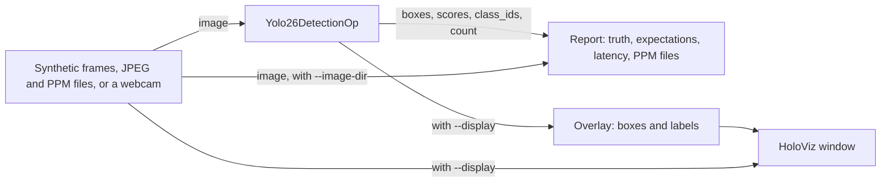

# YOLO26 Detection

This application detects objects in images on the GPU with an end-to-end
YOLO26 model. Its core is one reusable Holoscan SDK 5 operator,
`Yolo26DetectionOp`: an image goes in, as a `holoscan::schema::ImageT`, and
its detections come out as GPU tensors: boxes in the image's own pixels, a
score and a class for each, and their count. Inside, a CUDA kernel letterboxes
the image into the model's input, the SDK's TensorRT inference library
(HoloInfer) runs the model, and a second kernel turns its output into
detections. YOLO26 needs no non-maximum suppression, so nothing else runs.

> **The model is AGPL-3.0.** YOLO26 weights and the Ultralytics software that
> exports them are licensed under the
> [GNU Affero General Public License v3.0](https://github.com/ultralytics/ultralytics/blob/main/LICENSE)
> (or an Ultralytics Enterprise License). Neither is part of this repository,
> which is Apache 2.0 and contains no Ultralytics code or weights. They are
> downloaded and exported separately, on your machine, by the steps in
> [Prepare the model](#prepare-the-model); the terms that apply to using and
> distributing the model and anything built with it are yours to review. The
> tests and the `ci` mode need neither: they use a stand-in model that the
> application writes itself.



## What it computes

The model takes a square `S x S` input (`S` = 640 by default). An image of
`W x H` pixels is scaled by `r = min(S / W, S / H)` to
`round(W * r) x round(H * r)` (rounded half to even), centered, and the rest
is filled with gray 114; where the padding is odd, the extra pixel goes on the
right or the bottom. This is the geometry of the Ultralytics predictor, so
boxes map back to the image as they do there. Each input pixel is a bilinear
sample of the image with pixel centers aligned and edges clamped, as OpenCV's
`INTER_LINEAR` computes it, in RGB order and divided by 255, written as
float32 `[1, 3, S, S]` planes. The kernel reads RGB8, BGR8, RGBA8 and BGRA8
images, rows any pitch apart, and ignores alpha.

An end-to-end YOLO26 export gives `[1, N, 6]` rows of
`[x1, y1, x2, y2, score, class]` in input pixels, best first (`N` = 300).
The decode keeps a row when its score is finite and at least the threshold,
its class value rounds to a class below `num_classes`, and its box, mapped
back as `x = (u - pad_left) / r`, `y = (v - pad_top) / r` and clamped to
`[0, W] x [0, H]`, still has a positive width and height. Kept rows keep their
order, up to `max_detections`; when a frame has more, the operator logs a
warning once per run.

On the COCO image the tests use, the detections match those of Ultralytics'
own predictor running the same ONNX file with ONNX Runtime to within 0.002 in
score and 0.1 pixel in each box edge.

## The operator

| Port | Direction | Type |
| --- | --- | --- |
| `image` | in | `ImageT`: RGB8, BGR8, RGBA8 or BGRA8, uint8 `[H, W, C]`, pixels packed within each row; GPU memory on device 0, or host or pinned memory |
| `boxes` | out | `Tensor`: float32 `[max_detections, 4]`, `x1, y1, x2, y2` in image pixels; GPU memory |
| `scores` | out | `Tensor`: float32 `[max_detections]`; GPU memory |
| `class_ids` | out | `Tensor`: int32 `[max_detections]`; GPU memory |
| `count` | out | `Tensor`: int32 `[1]`, the detections in this image; GPU memory |

Slots from `count` on are zero. All four outputs carry the image's capture
time and frame id. They go out one after another: should one fail to go out,
those before it have been delivered alone and the frame fails. Pair them by
capture time, with an `OnAligned` contract, as the application's report does.
Images may change size from frame to frame; images in host memory are copied
to the GPU through a staging buffer that grows with the largest one.

| Setting | Default | Meaning |
| --- | --- | --- |
| `model` | none | An `.onnx` end-to-end YOLO26 export, or a TensorRT engine built for this GPU |
| `input_size` | `640` | The model's input side `S`, a multiple of 32 in 32..4096 |
| `score_threshold` | `0.25` | Minimum score, in `[0, 1]` |
| `max_detections` | `300` | Capacity of the outputs; further detections are dropped, the lowest scores first |
| `num_classes` | `80` | The model's classes; rows with another class value are dropped |
| `pad_value` | `114` | The letterbox border's gray level |
| `fp16` | `false` | Build the engine with FP16 kernels allowed |
| `cuda_graphs` | `true` | Let HoloInfer replay the inference as a CUDA graph |
| `build_workspace_bytes` | 1 GiB | TensorRT's workspace limit while it builds the engine |

Given an ONNX file, HoloInfer builds a TensorRT engine at `start()` and caches
it beside the file, named after the GPU, the TensorRT version and the
settings, so later runs load it in seconds. The first build of YOLO26n took
10 to 30 s on an RTX 5090. The cache is not keyed on the file's contents:
after exporting a model again to the same name, delete its
`<name>.*.engine.*` files (`prepare_model.py` does). `start()` fails, naming
the problem, when the model does not take `[1, 3, S, S]` or give `[1, N, 6]`
float32.

The operator uses HoloInfer directly rather than the SDK's `InferenceOp`,
which emits its outputs with its own activation time and no frame id: the
decode needs each image's letterbox, and every output must keep the image's
capture time.

### Use it in your graph

```cpp
#include "operators/yolo26_detection_op.hpp"

namespace yd = yolo26_detection;

auto detector = graph.op<yd::Yolo26DetectionOp>(
    "detector", yd::Yolo26DetectionConfig{.model = "/data/yolo26n.onnx",
                                          .score_threshold = 0.4F,
                                          .max_detections = 100});
graph.add_flow(camera->image, detector->image);      // Output<schema::ImageT>
graph.add_flow(detector->boxes, consumer->boxes);    // Input<Tensor>, and so on
```

The outputs are in GPU memory, so bind their device when compiling, as
`main.cpp` does:

```cpp
holoscan::CompileOptions options;
for (const char* port : {"boxes", "scores", "class_ids", "count"}) {
  options.deployment.bind_tensor_output_device(holoscan::TensorOutputDevicePlacement{
      .operator_path = "detector", .output_port = port, .device = holoscan::DeviceId{0}});
}
const auto plan = holoscan::compile(graph, std::move(options));
```

The operator is not installed as a library. To use it in another
application, build `cpp/operators/yolo26_detection_op.cpp`,
`cpp/detection/letterbox.cu` and `cpp/detection/decode.cu` with it and link
`holoscan::infer`; within this application's CMake project, link the
`yolo26_detection_operators` target. The kernels have no Holoscan dependency.

## Dependencies

- Linux on x86_64 or aarch64 with an NVIDIA GPU and a compatible driver.
- Holoscan SDK 5.0 Core, Sensor I/O, Inference (HoloInfer, with TensorRT
  10) and Visualization (HoloViz), and for the tests, Testing.
- CMake 4.0+, a C++20 compiler and the CUDA toolkit, with nvJPEG.
- Python 3.12–3.14 and the CLI pinned in the repository's
  [requirements.txt](../../requirements.txt) for repository workflows.
- For the `camera` mode: a V4L2 webcam offering YUYV, and a display.
- For the real model only: a separate Python environment with the
  `ultralytics` package and its ONNX exporter's dependencies, on the host.

## Prepare the model

The `demo`, `files` and `camera` modes and the real-model tests need YOLO26n exported to
ONNX with its end-to-end head. `prepare_model.py` downloads the pinned
`yolo26n.pt` from the Ultralytics release
[v8.4.0](https://github.com/ultralytics/assets/releases/tag/v8.4.0) and checks
its SHA-256 digest, exports it with the Ultralytics `yolo` command
(`format=onnx nms=False`), checks the export's input and output, and writes
`yolo26n.onnx` and `yolo26n.labels.txt`. It also downloads, and checks, the
COCO validation image `000000039769.jpg`, which is subject to the
[COCO terms of use](https://cocodataset.org/#termsofuse), into `images/`.
The script only runs the `yolo` command; it does not import Ultralytics.

Installing `ultralytics` runs code from the Python package index, and its
version and dependencies are not pinned by this repository. Install it in its
own virtual environment, not the one that holds the repository's tools, and
review what it pulls in. The script runs the exporter with
`YOLO_AUTOINSTALL=false`, so the exporter installs no further packages on its
own; install the ONNX packages it needs with it. Tested with
`ultralytics` 8.4.190:

```bash
python3 -m venv ~/ultralytics-venv
~/ultralytics-venv/bin/pip install ultralytics onnx onnxslim onnxruntime
python3 applications/yolo26_detection/prepare_model.py \
  --output data/yolo26_detection --yolo ~/ultralytics-venv/bin/yolo
```

Pass `--model yolo26s` (or `m`, `l`, `x`) for a larger pinned model,
`--weights your_model.pt` to export your own trained weights instead (without
a digest to check), `--imgsz` for another input size, and `--force` to export
again over an existing model. Copy your own JPEG or PPM images into
`data/yolo26_detection/images` for the `files` mode.

## Build and run

From the repository root, choose a development image matching the SDK:

```bash
export HOLOSCAN_CLI_BASE_IMAGE=nvcr.io/nvidia/clara-holoscan/holoscan:v5.0.0-cuda13
holoscan run yolo26_detection
holoscan run yolo26_detection ci
```

To build and run on the host instead, install the dependencies, set
`HOLOSCAN_SDK_ROOT` to the SDK installation and add `--local`.

| Mode | Behavior |
| --- | --- |
| `demo` (default) | YOLO26n on the prepared images, 300 frames looped, printing each image's detections once and the latency. |
| `files` | YOLO26n on each image in `data/yolo26_detection/images` once, printing the detections and writing each image with its boxes drawn. |
| `camera` | YOLO26n on a live webcam, with the detections drawn over it in a HoloViz window. |
| `ci` | 30 synthetic BGR8 frames through TensorRT with the stub model, every detection checked against the frame's known ones. Needs no download. |

The `demo` mode prints, for the COCO image:

```text
yolo26_detection: 000000039769.jpg: 4 detections
  cat (15) 0.912 [344.0, 24.6, 640.0, 374.9]
  cat (15) 0.898 [6.9, 55.1, 317.2, 466.1]
  remote (65) 0.857 [40.4, 74.0, 175.9, 118.6]
  couch (57) 0.297 [0.8, 0.6, 640.0, 480.0]
yolo26_detection: frames=300/300 detections=1200 latency_ms: mean=1.390 p50=1.268 p99=2.043 max=25.490
yolo26_detection: verdict=PASS
```

The latency is the time from a frame's capture by the source to its
detections on the host, including the JPEG decode; the first frame's
includes the warm-up.

`--model stub` writes and uses the stand-in model: an ONNX network with the
inputs and outputs of an end-to-end YOLO26 export that "detects", from the
pixels, red (class 0) and blue (class 1) regions, so the synthetic frames'
red and blue rectangles. It is written to the working directory, where its
engine is cached too. With it, each synthetic frame's detections are checked
against the rectangles: each box edge within a model input pixel or so
(`2 / r + 1` image pixels), the exact score, and nothing extra.

Each run prints the frame count, the detections, the latency and, as they
apply, the truth check and the expected detections found. A gap in the frame
ids fails the run, as does a run over files with nothing expected and no
detection at all, which most likely means a wrong model, input size or
threshold. Then comes a `verdict`: `PASS`, `FAIL`, or `STOPPED` when an
interrupt or a closed window ends the run early. It exits nonzero unless the
verdict is `PASS`, or `STOPPED` for a camera run without `--count`.

`--run-args` appends options to the mode's command, for example
`--run-args='--score-threshold 0.5 --fp16 true'`. `--expect FILE` lists
detections that named image files must yield, as lines of
`image,class_id,x1,y1,x2,y2`, each matched by a detection of the class with an
IoU of at least `--expect-iou` (default 0.8). `--image-dir DIR` writes each
frame with its boxes drawn as `DIR/detections_NNNNNN.ppm`. `--encoding bgr8`
decodes the files as BGR8. Run the executable with `--help` for every option.

The modes build the application without its tests; `holoscan test` builds
them separately. The `ci` mode also leaves out the display
(`-DYOLO26_DETECTION_ENABLE_VISUALIZATION=OFF`), so it builds without
HoloViz.

### Webcam

Allow the container to open a window, then run the `camera` mode:

```bash
xhost +local:
holoscan run yolo26_detection camera
```

With a [standalone build](#standalone-build), run it from the repository
root:

```bash
./build/yolo26-standalone/yolo26_detection --model data/yolo26_detection/yolo26n.onnx \
  --labels data/yolo26_detection/yolo26n.labels.txt --source camera --device /dev/video0
```

The window shows each frame with its boxes, a color per class, and a
`<class> 0.87` label above each box. The first run builds the TensorRT engine
from the ONNX file, which takes 10 to 30 s, and caches it beside the file; later
runs start in seconds. The camera must offer YUYV at the requested size
(default 640x480, or for example `--width 1280 --height 720`); otherwise the
run stops with the sizes it offers. To use another camera, list them with
`v4l2-ctl --list-devices` and pass one with `--device /dev/videoN`. The run
lasts until Ctrl+C or the window is closed. `--display true` shows synthetic
frames too, and `--display false` runs the camera without a window.

## Performance

On an RTX 5090 (driver 595.91.07, shared with another process) with SDK 5.0.0,
CUDA 13.2 and TensorRT 10.16, for YOLO26n at 640 on the 640x480 COCO image,
the GPU work per frame is a median of:

| Stage | FP32 engine | FP16 engine |
| --- | --- | --- |
| Letterbox kernel | 2.4 µs | 2.4 µs |
| TensorRT, 210 to 216 kernels | 706 µs | 386 µs |
| Decode kernel | 1.7 µs | 1.7 µs |
| Letterbox start to decode end | 754 µs | 442 µs |

From capture to detections on the host it takes a median of 1.27 ms with the
FP32 engine and 0.96 ms with FP16, the source's JPEG decode included.
Measured with Nsight Systems 2026.4.1 over 300 frames, tracing CUDA graph
nodes, from:

```bash
nsys profile -t cuda --cuda-graph-trace=node --sample=none --cpuctxsw=none -o yolo26 \
  ./yolo26_detection --model yolo26n.onnx --source files --images images \
  --loop true --count 300 --period-ms 10
```

## Standalone build

```bash
cmake -S applications/yolo26_detection -B build/yolo26-standalone \
  -Dholoscan_ROOT="$HOLOSCAN_SDK_ROOT" -DCMAKE_CUDA_ARCHITECTURES=native \
  -DBUILD_TESTING=OFF
cmake --build build/yolo26-standalone --parallel
./build/yolo26-standalone/yolo26_detection --model stub --count 30
```

`-DBUILD_TESTING=OFF` leaves out the tests, which need the SDK's testing
component.

## Tests

```bash
holoscan test yolo26_detection --no-xvfb
```

To build and test on the host instead, set `HOLOSCAN_SDK_ROOT` as above and
add `--local`. The tests of the real model run when the model has been
prepared in `data/yolo26_detection`, and are reported as skipped otherwise;
point them elsewhere with
`--cmake-options='-DYOLO26_DATA_DIR=/path/to/prepared'`.

The suite checks:

- The letterbox: its geometry for wide and tall images with even and odd
  padding, half-to-even rounding and tiny and huge images; the kernel against
  a host evaluation, bit for bit, for every encoding, with padded rows,
  downscaling and upscaling; and that pixel centers are aligned, channels in
  RGB order, the padding in place and alpha ignored.
- The decode against a host decode: the threshold and its boundary, invalid
  and non-finite classes, scores and corners, clamping, order, capacity, the
  count and the zeroed slots, inputs larger than one block, and letterboxes
  padded on either axis.
- The operator through the SDK's operator test harness, with the stub model
  and TensorRT: every encoding, from GPU, host and pinned memory, wide, tall
  and small images, input sizes of 640 and 320, changing image sizes,
  mislabeled channels (which swap the classes), the threshold and the
  capacity, provenance on every output, and unusable images, settings and
  models.
- The detection overlay through the harness: each box's edges in its class's
  color, the labels and their position, and a clear overlay without
  detections. The webcam's YUYV conversion, without the SDK.
- The application with the stub model on synthetic frames and on JPEG
  (baseline and progressive) and PPM files that a fixture writes, including
  FP16 engines, engine files, image output, expected detections, and the exit
  status and verdict of failed, stopped and invalid runs, a missing camera,
  and the display graph.
- With the real model, the two cats and the remote that the Ultralytics
  predictor finds in the COCO image, in RGB8 and BGR8 and with an FP16 engine.
- Without the SDK or a GPU, `prepare_model.py`: reading and checking exports,
  checksums, a failed or missing exporter, and reuse of prepared files.

Validated with SDK 5.0.0 on x86_64 (RTX 5090, CUDA 13.2, TensorRT 10.16; RTX
5080 Laptop GPU, CUDA 13.0, TensorRT 10.13, with a USB webcam and an Intel
RealSense) and on Jetson AGX Thor (JetPack 7, CUDA 13.0, TensorRT 10.15), where
the real model's FP32 and FP16 engines give the same detections as on x86_64,
and the camera mode ran live on a ZED-M (V4L2, 2560x720 and 1344x376), with and
without the display.

## License

Apache 2.0; see [LICENSE](LICENSE). The YOLO26 model is not covered by it; see
the note at the top.
